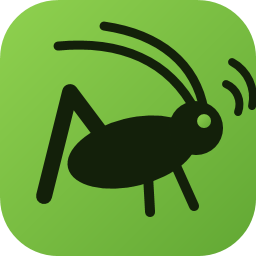
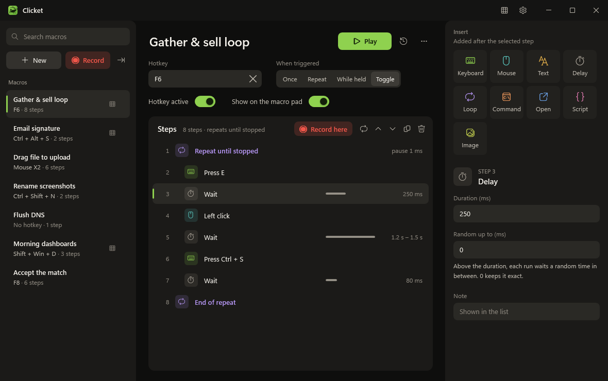
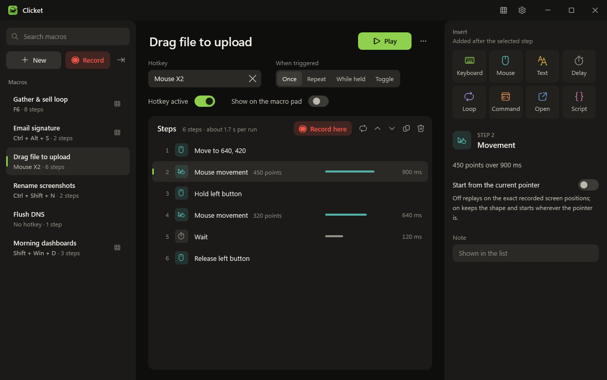
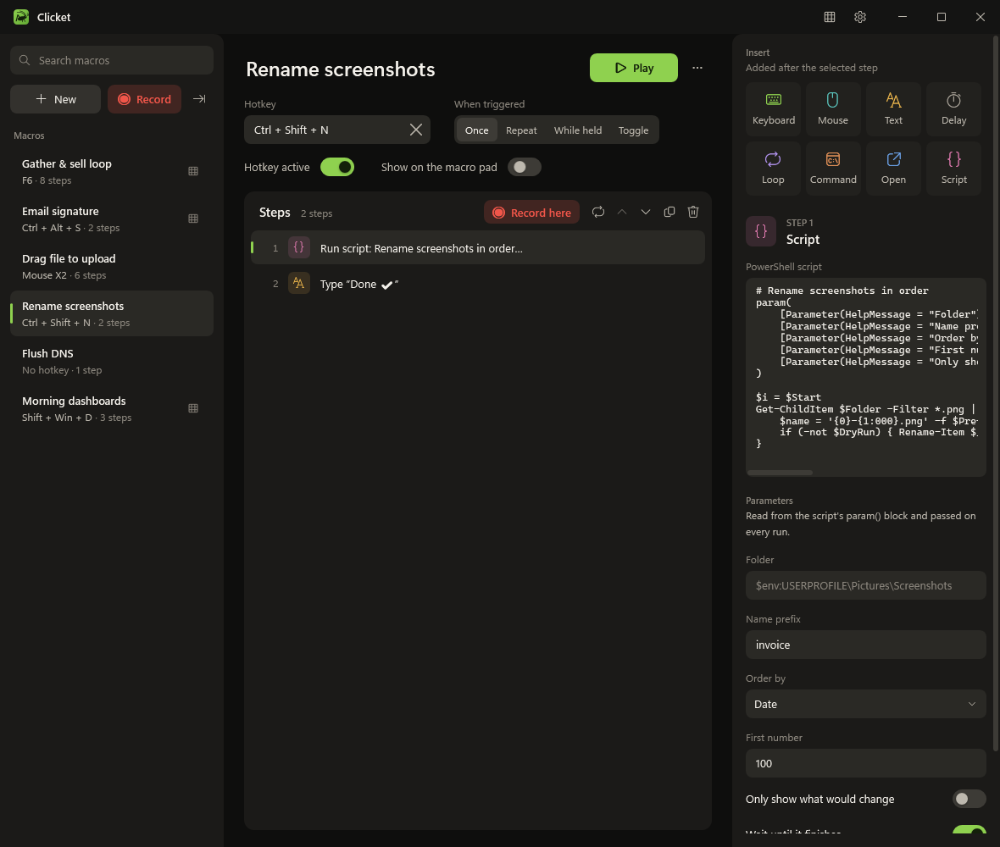

<p align="center">
  
</p>

<h1 align="center">Clicket</h1>

<p align="center">
  Record what you do with the keyboard and mouse once, then replay it with a single key, exactly as you did it.
</p>

<p align="center">
  <a href="https://github.com/luingry/Clicket/releases/latest"><strong>⬇ Download the latest version</strong></a>
  &nbsp;·&nbsp; Windows 10 / 11 &nbsp;·&nbsp; English · Português (Brasil)
  &nbsp;·&nbsp; <a href="README.pt-BR.md">Leia em português</a>
</p>

<p align="center">
  
</p>

*Click + cricket: a cricket never stops clicking. Neither will your macros.*

## What it does

- **Records you, organically.** Keys, clicks, the wheel and the mouse path itself, sample by sample, with the real timing between them.
- **Replays exactly.** Every recorded point lands on its original clock (99% within 0.2 ms in tests), so drags, drawings and game moves come out the same every time.
- **Builds macros step by step.** Insert keyboard, mouse, text, delay, loop, command and open steps, then edit any of them on the right. Nothing to code.
- **Or brings your own script.** A Script step runs PowerShell, and its parameters show up as a ready-made settings form.
- **Runs from any hotkey.** Any key combination or a mouse side button: play once, repeat N times, repeat while held, or toggle on and off.
- **Stays out of the way.** A tiny tray app that does nothing until you press a hotkey. One key (Ctrl + Alt + End by default) stops every macro instantly and releases anything still held down.
- **Macro pad.** A small floating panel of your favourite macros that never steals focus, so a click plays straight into the window you are working in.
- **Speaks your language.** English or Brazilian Portuguese, following SwissTechKnife automatically when it is installed.

<p align="center">
  
</p>

## How to install

1. Download `Clicket-Setup-x.y.z.exe` from the [releases page](https://github.com/luingry/Clicket/releases/latest).
2. Open it. Installation takes a few seconds and needs no administrator password.

The installer has no digital signature yet, so Windows may show a SmartScreen warning: choose **More info**, then **Run anyway**.

**Using SwissTechKnife?** Install **Clicket** from its module store instead. It runs inside SwissTechKnife, which then starts it with Windows and shows its icon in the notification area.

## How to use

| To... | Do this |
|---|---|
| Record a macro | Press **Record**, do the actions, then press **Stop**. To record from anywhere, pick a recording hotkey in Settings (none by default, so nothing clashes with your other apps) |
| Click as fast as possible | Clicks and key presses are instant by default, like AutoHotkey; set **Hold time** on the step if a game needs to see the press held |
| Delete a macro | Point at it in the list and click the trash twice |
| Build one by hand | Press **New**, then click the tiles under **Insert**: each step goes after the selected one |
| Give it a hotkey | Click the **Hotkey** field and press the keys (a mouse side button works too) |
| Test it | Press **Play**: it starts after 3 seconds, so you can switch to the target window |
| Repeat part of it | Select the steps and press the loop button above the list |
| Stop everything | **Ctrl + Alt + End**, from anywhere |
| Move or edit steps | **Alt + ↑ / ↓** moves, **Ctrl + D** duplicates, **Del** deletes, **Ctrl + Z** undoes, **Ctrl + C / V** copies steps between macros |
| Share a macro | **⋯ → Export** saves a `.clicket` file; **Import** on the left reads one |

Step types:

| Step | What it does |
|---|---|
| Keyboard | Press, hold or release a key, including combinations such as Ctrl + S |
| Mouse | Click, double-click, hold, release, move to a point (pick it on screen), move by an offset, or scroll |
| Movement | A recorded mouse path, replayed point by point; optionally from wherever the pointer is |
| Text | Types any text, in any language, emoji included |
| Delay | Waits a set time, or a random time within a range |
| Loop | Repeats the steps inside it a number of times, or until stopped, with a pause between rounds (1 ms at minimum) |
| Command | Runs a command line in Command Prompt or PowerShell, optionally hidden and waiting for it |
| Open | Opens a file, folder, program or web address |
| Script | Runs your own PowerShell script; whatever its `param()` block declares becomes fields in the editor (text, numbers, on/off, lists), so you adjust it without touching the code |

### Scripts with a setup panel

Declare parameters the usual PowerShell way and Clicket draws the form for you, the way an AutoHotkey script builds its GUI:

```powershell
# Rename screenshots in order
param(
    [Parameter(HelpMessage = "Name prefix")] [string] $Prefix = "shot",
    [Parameter(HelpMessage = "Order by")] [ValidateSet('Date', 'Name')] [string] $Order = 'Date',
    [Parameter(HelpMessage = "First number")] [int] $Start = 1,
    [Parameter(HelpMessage = "Only show what would change")] [switch] $DryRun
)
```

`HelpMessage` is the field's label, `[int]`/`[double]` give number fields, `[switch]`/`[bool]` a switch and `ValidateSet` a list. Fields left empty use the script's own default.

<p align="center">
  
</p>

## Privacy

Clicket watches the keyboard and mouse only to catch its hotkeys and, while you record, to capture what you do. Nothing leaves your computer: macros and settings stay in `%APPDATA%\Clicket` (or in the module's folder under SwissTechKnife). Text you type during a recording is stored in that macro, so do not record passwords.

## For developers

```powershell
powershell -ExecutionPolicy Bypass -File scripts/build.ps1        # build, draw the icon, run the tests
src/Clicket/bin/Release/net48/Clicket.exe --snapshot snapshots    # render every screen to PNG
powershell -ExecutionPolicy Bypass -File scripts/pack-module.ps1  # SwissTechKnife module package
```

C#/WPF on .NET Framework 4.8, which ships with Windows, and no other dependency: a ~200 KB exe. Low-level hooks live on one dedicated thread that sleeps until input arrives; each macro plays on its own thread with a high-resolution waitable timer. Rules are in [AGENTS.md](AGENTS.md), the design in [docs/DESIGN_SYSTEM.md](docs/DESIGN_SYSTEM.md), the module in [docs/SWISSTECHKNIFE.md](docs/SWISSTECHKNIFE.md) and the history in [CHANGELOG.md](CHANGELOG.md).

## License

[MIT](LICENSE)
