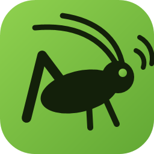
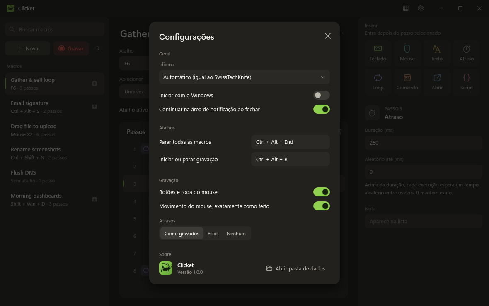

  

<h1 align="center">Clicket</h1>

  Grave uma vez o que você faz com teclado e mouse e repita com uma única tecla, exatamente como você fez.

  <a href="https://github.com/luingry/Clicket/releases/latest"><strong>⬇ Baixar a versão mais recente</strong></a>
  &nbsp;·&nbsp; Windows 10 / 11 &nbsp;·&nbsp; Português (Brasil) · English
  &nbsp;·&nbsp; <a href="README.md">Read in English</a>

  

*Click + cricket (grilo): o grilo não para de fazer clique. Suas macros também não.*

## O que faz

- **Grava você de forma orgânica.** Teclas, cliques, a roda e o próprio trajeto do mouse, ponto a ponto, com o tempo real entre eles.
- **Reproduz exatamente.** Cada ponto gravado cai no seu horário original (99% em até 0,2 ms nos testes), então arrastos, desenhos e movimentos em jogos saem iguais toda vez.
- **Monta macros passo a passo.** Insira passos de teclado, mouse, texto, atraso, loop, comando e abrir, e edite qualquer um à direita. Sem programar.
- **Ou usa o seu próprio script.** Um passo Script roda PowerShell, e os parâmetros declarados no `param()` viram um formulário de configuração pronto (texto, números, liga/desliga, listas), como a GUI de um script do AutoHotkey.
- **Roda com qualquer atalho.** Qualquer combinação de teclas ou um botão lateral do mouse: uma vez, repetir N vezes, enquanto segurar ou alternar liga/desliga.
- **Não atrapalha.** Um app leve na área de notificação que não faz nada até você apertar um atalho. Uma tecla (Ctrl + Alt + End, por padrão) para todas as macros na hora e solta tudo que ainda estiver pressionado.
- **Painel de macros.** Um painel flutuante com suas macros favoritas que nunca rouba o foco: um clique executa direto na janela em que você está.
- **Fala seu idioma.** Português (Brasil) ou inglês, seguindo o SwissTechKnife automaticamente quando ele está instalado.

## Como instalar

1. Baixe `Clicket-Setup-x.y.z.exe` na [página de versões](https://github.com/luingry/Clicket/releases/latest).
2. Abra o arquivo. A instalação leva poucos segundos e não pede senha de administrador.

O instalador ainda não tem assinatura digital, então o Windows pode mostrar um aviso do SmartScreen: escolha **Mais informações** e depois **Executar assim mesmo**.

**Usa o SwissTechKnife?** Instale o **Clicket** pela loja de módulos. Ele roda dentro do SwissTechKnife, que passa a iniciá-lo com o Windows e a mostrar o ícone na área de notificação.

## Como usar

| Para... | Faça isso |
|---|---|
| Gravar uma macro | Clique em **Gravar**, faça as ações e clique em **Parar**. Para gravar de qualquer lugar, escolha um atalho de gravação nas Configurações (vem vazio, para não conflitar com seus outros apps) |
| Clicar o mais rápido possível | Cliques e teclas são instantâneos por padrão, como no AutoHotkey; ajuste **Tempo pressionado** no passo se um jogo precisar perceber o toque |
| Excluir uma macro | Passe o mouse sobre ela na lista e clique duas vezes na lixeira |
| Montar à mão | Clique em **Nova** e nos blocos de **Inserir**: cada passo entra depois do selecionado |
| Dar um atalho | Clique no campo **Atalho** e pressione as teclas (botão lateral do mouse também vale) |
| Testar | Clique em **Executar**: começa após 3 segundos, para dar tempo de ir para a janela de destino |
| Repetir uma parte | Selecione os passos e clique no botão de loop acima da lista |
| Parar tudo | **Ctrl + Alt + End**, de qualquer lugar |
| Mover ou editar passos | **Alt + ↑ / ↓** move, **Ctrl + D** duplica, **Del** exclui, **Ctrl + Z** desfaz, **Ctrl + C / V** copia passos entre macros |
| Compartilhar uma macro | **⋯ → Exportar** salva um arquivo `.clicket`; **Importar**, à esquerda, lê um |

## Privacidade

O Clicket observa teclado e mouse só para reconhecer os atalhos e, enquanto você grava, para capturar o que você faz. Nada sai do seu computador: macros e configurações ficam em `%APPDATA%\Clicket` (ou na pasta do módulo, no SwissTechKnife). O que você digita durante uma gravação fica salvo na macro, então não grave senhas.

## Para desenvolvedores

Veja a seção [For developers](README.md#for-developers) do README em inglês.

## Licença

[MIT](LICENSE)
